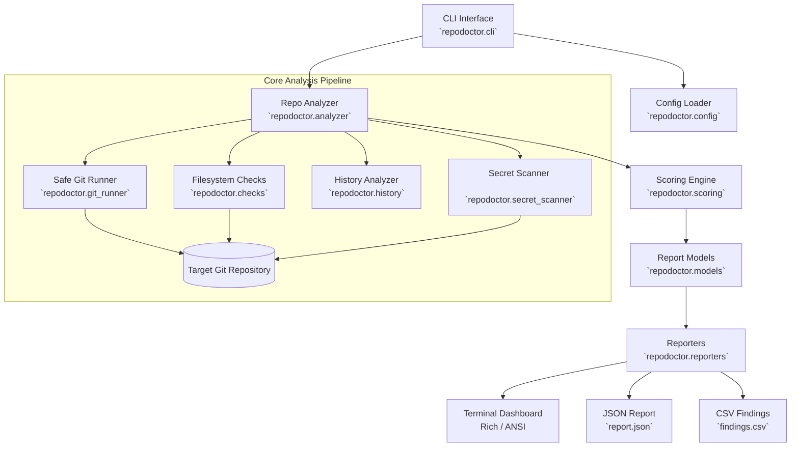

# 🩺 RepoDoctor — Git Repository Health Checker

[](https://www.python.org/downloads/)
[](LICENSE)
[](https://git-scm.com/)
[](tests/)

**RepoDoctor** is a professional, developer-friendly command-line interface (CLI) application inspired by modern DevOps and cybersecurity diagnostic tools. It conducts comprehensive, read-only diagnostic audits on Git repositories, identifies hygiene and maintenance issues, detects potential exposed credentials, computes a transparent 0–100 health score, and provides actionable recommendations before publishing or releasing software.

---

## Table of Contents

- [Motivation & Problem Statement](#motivation--problem-statement)
- [Key Features](#key-features)
- [Architecture & Workflow](#architecture--workflow)
- [Installation](#installation)
- [CLI Command Reference](#cli-command-reference)
  - [Full Health Analysis (`analyze`)](#1-full-health-analysis-analyze)
  - [Working Tree Status (`status`)](#2-working-tree-status-status)
  - [Commit History & Contributor Analytics (`history`)](#3-commit-history--contributor-analytics-history)
  - [CI/CD Integration (`--fail-under`)](#4-cicd-pipeline-integration---fail-under)
  - [JSON & CSV Exports](#5-multi-format-reporting-json--csv)
- [Health Scoring System & Heuristics](#health-scoring-system--heuristics)
- [Configuration (`repodoctor.toml`)](#configuration-repodoctortoml)
- [Secret Pattern Scanner](#secret-pattern-scanner)
- [Sample Outputs](#sample-outputs)
  - [Terminal Dashboard](#terminal-dashboard-output)
  - [JSON Report Structure](#json-report-sample)
  - [CSV Findings Structure](#csv-findings-sample)
- [Safety, Privacy, and Read-Only Guarantees](#safety-privacy-and-read-only-guarantees)
- [Running Automated Tests](#running-automated-tests)
- [Known Limitations](#known-limitations)
- [Roadmap](#roadmap)
- [Contributing](#contributing)
- [License](#license)

---

## Motivation & Problem Statement

Modern software development moves fast. In the rush to commit features and ship updates, repositories frequently accumulate maintenance debt that compromises project quality and security:

- **Uncommitted & Untracked Cruft:** Lingering unstaged edits, untracked test fixtures, and dirty working trees lead to release mistakes.
- **Accidentally Committed Artifacts:** Bytecode (`__pycache__`, `*.pyc`), OS metadata (`.DS_Store`, `Thumbs.db`), dependency bundles (`node_modules`), or `.env` files end up tracked in Git history.
- **Oversized Binary Blobs:** Accidentally tracked datasets, virtual environments, or compiled binaries cause repository bloat and slow clone times.
- **Missing Documentation & Standards:** Repositories without `README.md`, `.gitignore`, or licenses create barriers for contributors and users.
- **Exposed Sensitive Credentials:** Accidental commits of API keys, tokens, or private keys present catastrophic security hazards.
- **Stale Repositories:** Unmaintained repositories with dormant commit activity require clear visibility before relying on them in production.

**RepoDoctor** provides a local, zero-dependency, automated health checker to audit, score, and remediate these problems within seconds.

---

## Key Features

- **Safe Read-Only Operations:** Zero repository modifications. RepoDoctor never commits, pushes, switches branches, or alters Git configuration.
- **Dynamic Terminal Dashboard:** Developer-tool aesthetic with colored status indicators (`[PASS]`, `[WARN]`, `[FAIL]`, `[INFO]`), health badges, and clean tabular alignments (powered by `rich` when installed, with seamless ANSI fallback).
- **Rule-Based Health Scoring:** Transparent score out of 100 with clear deductions, deduplication, and tier classifications (*Excellent*, *Good*, *Needs Attention*, *Poor*).
- **Filesystem & Hygiene Audits:** Checks for `README`, `.gitignore`, `LICENSE`, large tracked files exceeding configurable limits, tracked generated/cache files, and empty directory structures.
- **Commit History & Contributor Analytics:** Machine-readable parsing of commit history, top contributors, date breakdowns, and commit recency.
- **Heuristic Secret Detection:** Local detection of exposed AWS keys, GitHub tokens, Slack tokens, Stripe keys, private keys, and generic credential assignments with automatic masking (`AKIA************MPLE`).
- **Multiple Output Formats:** Terminal UI, machine-readable JSON reports, and CSV finding spreadsheets.
- **CI/CD Automation Friendly:** Documented process exit codes and `--fail-under <N>` threshold flag for automated pipeline gates.
- **TOML Configuration:** Full customization via `repodoctor.toml`.
- **Zero Required External Dependencies:** Operates out of the box using only Python 3.11+ standard library and Git CLI (`rich` is purely optional for enhanced formatting).

---

## Architecture & Workflow

RepoDoctor follows a modular pipeline architecture with strict separation of concerns:



### Module Responsibilities

| Module | Responsibility |
|---|---|
| `cli.py` | Argument parsing (`argparse`), CLI validation, subcommand routing, exit code management. |
| `git_runner.py` | Safe subprocess wrapper around Git commands (`shell=False`, timeouts, error isolation). |
| `models.py` | Dataclasses and enums (`Severity`, `Finding`, `RepoInfo`, `RepoStatus`, `AnalysisReport`). |
| `config.py` | TOML configuration loader (`tomllib`), bounds checking, and default settings. |
| `checks.py` | Structure inspection (README, `.gitignore`, license, large files, tracked generated files). |
| `history.py` | Machine-readable log parsing, contributor counts, commit age, and staleness detection. |
| `secret_scanner.py` | Heuristic regex scanner for API keys/tokens with masking and binary file skips. |
| `scoring.py` | Weighted point calculation, deduplication, clamping (0-100), and tier classification. |
| `analyzer.py` | Central orchestrator coordinating checks, status, history, secrets, and scoring. |
| `reporters.py` | Terminal dashboard (Rich/ANSI), JSON exporter, and CSV findings exporter. |

---

## Installation

### Prerequisites
- Python 3.11 or higher
- Git CLI (available in system `PATH`)

### Option 1: Direct Execution (No Installation Required)

Clone the repository and run directly with Python:

```bash
git clone https://github.com/your-username/repodoctor.git
cd repodoctor
python main.py --help
```

### Option 2: Editable Package Installation

To install `repodoctor` as a system/environment command:

```bash
cd repodoctor
pip install -e .
```

After installation, invoke the command directly:
```bash
repodoctor --help
```

### Optional Enhanced Styling (`rich`)

RepoDoctor works out-of-the-box with standard ANSI terminals. For enhanced visual tables and rounded panels:

```bash
pip install rich
```

---

## CLI Command Reference

### 1. Full Health Analysis (`analyze`)

Run a comprehensive audit on the current directory or target path:

```bash
# Analyze current repository
python main.py analyze .

# Analyze specific repository path
python main.py analyze "D:/Projects/MyProject"

# Plain text output (no colors/rich formatting)
python main.py analyze . --no-color

# Enable verbose diagnostic logging
python main.py analyze . -v
```

### 2. Working Tree Status (`status`)

Quick status inspect displaying working tree cleanliness, staged files, modified files, untracked files, and deletions:

```bash
python main.py status .
```

### 3. Commit History & Contributor Analytics (`history`)

Analyze commit history, recency, and contributor distribution:

```bash
# Limit to latest 20 commits (default)
python main.py history . --limit 20

# Filter commits within a time window (e.g., last 30 days)
python main.py history . --since 30d
```

### 4. CI/CD Pipeline Integration (`--fail-under`)

Enforce minimum repository health standards in CI workflows. If the health score is strictly below the threshold, RepoDoctor exits with code `1`:

```bash
python main.py analyze . --fail-under 80
```

#### Documented Process Exit Codes

| Exit Code | Meaning | Typical Scenario |
|---|---|---|
| `0` | Success | Analysis completed successfully (and score >= `--fail-under` threshold if set). |
| `1` | Health Threshold Failed | Calculated health score fell below `--fail-under` threshold. |
| `2` | CLI / Config Error | Invalid argument values, malformed `--fail-under`, or bad `repodoctor.toml`. |
| `3` | Git / Target Error | Directory does not exist, path is not inside a Git repository, or Git is missing. |
| `4` | System / Execution Error | Unhandled exception or unexpected system failure. |

### 5. Multi-Format Reporting (JSON & CSV)

Export analysis reports for downstream tooling, documentation, or compliance logs:

```bash
# Export complete analysis to JSON
python main.py analyze . --format json --output report.json

# Export tabular findings to CSV
python main.py analyze . --format csv --output findings.csv

# Overwrite existing output file safely using --overwrite (-f)
python main.py analyze . --format json --output report.json --overwrite
```

### 6. Custom Detection Thresholds

```bash
# Flag tracked files exceeding 25 MB (default is 10 MB)
python main.py analyze . --large-file-mb 25

# Explicitly disable secret pattern scanning
python main.py analyze . --no-secrets

# Specify custom configuration file
python main.py analyze . --config path/to/custom-repodoctor.toml
```

---

## Health Scoring System & Heuristics

RepoDoctor uses a transparent, rule-based scoring engine. Every repository starts with **100 points**. Applicable deductions are subtracted down to a lower bound of **0**.

> [!NOTE]
> RepoDoctor measures **repository maintenance and hygiene**, not software correctness, runtime performance, or code design.

### Deduction Rules & Weights

| Issue Identifier | Severity | Category | Default Deduction | Description |
|---|---|---|---|---|
| `NO_COMMITS` | HIGH | status | -15.0 pts | Freshly initialized repository without commit history. |
| `MISSING_README` | HIGH | documentation | -12.0 pts | Root directory lacks a README file (`README.md`, `README.rst`, etc.). |
| `LARGE_FILES` | HIGH | structure | -10.0 pts | Tracked files exceeding configured threshold (default 10 MB). |
| `SECRETS_DETECTED` | CRITICAL | security | -20.0 pts | Tracked files contain potential API keys, tokens, or private keys. |
| `TRACKED_GENERATED` | MEDIUM | structure | -8.0 pts | Accidental cache, bytecode, or build files tracked (`*.pyc`, `.DS_Store`). |
| `MISSING_GITIGNORE` | MEDIUM | structure | -8.0 pts | Missing root `.gitignore` configuration file. |
| `UNCOMMITTED_CHANGES` | LOW | status | -5.0 pts | Staged, modified, or deleted tracked files in working tree. |
| `STALE_REPOSITORY` | LOW | history | -5.0 pts | No commit activity within configured stale threshold (default 180 days). |
| `DETACHED_HEAD` | MEDIUM | status | -4.0 pts | HEAD is detached from any local branch. |
| `UNTRACKED_FILES` | LOW | status | -3.0 pts | Untracked files present in working directory. |
| `EMPTY_DIRECTORIES` | LOW | structure | -2.0 pts | Empty project folders not tracked by Git. |
| `MISSING_LICENSE` | INFO | documentation | 0.0 pts | Informational notification; recommended before publishing open source. |

### Finding Deduplication
Duplicate findings sharing the same rule ID (for instance, five large files triggering `LARGE_FILES`) only deduct points **once**, preventing individual categories from unfairly zeroing out an otherwise healthy repository score.

### Classification Bands

- **90–100:** `Excellent` — Exceptional repository hygiene; release-ready.
- **75–89:** `Good` — Well-maintained repository with minor cosmetic or organization items to address.
- **50–74:** `Needs Attention` — Several maintenance issues, missing documentation, or untracked generated files.
- **0–49:** `Poor` — Serious repository hygiene issues, critical security flags, or uncommitted sprawl.

---

## Configuration (`repodoctor.toml`)

RepoDoctor automatically reads `repodoctor.toml` from the repository root, or from a path supplied via `--config <path>`.

```toml
# repodoctor.toml — RepoDoctor Configuration

[analysis]
# Maximum allowed file size for tracked files (in Megabytes) before warning
large_file_mb = 10.0

# Number of commits to inspect in history checks
commit_history_limit = 50

# Stale activity threshold in days (warn if no commits in this many days)
stale_days_threshold = 180

# Whether to enable secret pattern scanning by default
check_secrets = true

# Maximum file size (in Kilobytes) to scan for secret patterns
max_scan_file_size_kb = 1024

[exclusions]
# Directory names to exclude from secret scanning and structure checks
ignored_dirs = [
    ".git",
    ".venv",
    "venv",
    "env",
    ".env",
    "node_modules",
    "__pycache__",
    ".pytest_cache",
    ".idea",
    ".vscode",
    "build",
    "dist",
    "htmlcov"
]

# File patterns (glob syntax) to ignore during checks
ignored_patterns = [
    "*.min.js",
    "*.min.css",
    "*.lock",
    "package-lock.json",
    "poetry.lock",
    "*.map"
]

[scoring.deductions]
# Point deductions subtracted from 100 for each detected issue
uncommitted_changes = 5.0
untracked_files = 3.0
detached_head = 4.0
missing_readme = 12.0
missing_gitignore = 8.0
missing_license = 0.0
large_files = 10.0
tracked_generated = 8.0
empty_directories = 2.0
stale_repository = 5.0
secrets_detected = 20.0
no_commits = 15.0

[output]
# Default output format: "text", "json", or "csv"
default_format = "text"
# Colorize terminal output
color = true
```

---

## Secret Pattern Scanner

The built-in secret scanner inspects tracked repository files for accidentally committed credentials.

### Supported Patterns

1. **AWS Access Key ID:** Patterns matching `AKIA[0-9A-Z]{16}`.
2. **GitHub Personal Access Tokens:** Classic `ghp_[a-zA-Z0-9]{36}` and fine-grained `github_pat_...`.
3. **Slack API Tokens:** Tokens matching `xoxb-...`, `xoxp-...`.
4. **Stripe Secret Keys:** Tokens matching `sk_live_[0-9a-zA-Z]{24}`.
5. **Private Key Headers:** Headers matching `-----BEGIN (RSA|DSA|EC|OPENSSH)? PRIVATE KEY-----`.
6. **Hardcoded Secret Assignments:** Assignments matching `api_key = "..."`, `secret_key = "..."`, `password = "..."`.

### Security Safeguards

- **Masked Evidence:** RepoDoctor **never** displays complete secret values in logs, terminal output, or reports (e.g. `AKIA************MPLE`).
- **Binary File Skipping:** Automatically inspects initial file bytes and skips binary objects to prevent corruption or performance issues.
- **File-Size Bounds:** Files exceeding `max_scan_file_size_kb` (default 1 MB) are skipped.
- **Zero Network Traffic:** All scanning is 100% local. No repository contents or tokens are ever transmitted off the machine.

---

## Sample Outputs

### Terminal Dashboard Output

```text
========================================================================
 RepoDoctor — Git Repository Health Checker (v1.0.0)
========================================================================

 Repository:  MyProject (D:/Projects/MyProject)
 Branch:      main
 Latest Hash: 3a9f2c1b (2026-10-21)

 Repository Health: 82/100 — GOOD

------------------------------------------------------------------------
 [PASS] Valid Git repository detected
 [PASS] Commit history found
 [PASS] Active branch attached
 [PASS] Documentation found (README.md)
 [PASS] .gitignore configuration found
 [PASS] License file detected (LICENSE)
 [PASS] No exposed secret patterns detected
 [WARN] Working tree has uncommitted changes (-5 pts)
        ↳ Modified (2): app.py, models.py
 [WARN] Large tracked file(s) exceed 10MB threshold (-10 pts)
        ↳ data/raw_dataset.csv (14.2 MB)
 [INFO] Missing open-source license file
------------------------------------------------------------------------

Summary:
 Passed checks: 7
 Warnings:      2
 Errors:        0
 Info notices:  1

Recommendations:
 1. Commit your changes (`git commit -m ...`) or stash them (`git stash`) before releasing.
 2. Consider using Git LFS (Large File Storage) or moving large datasets/binaries out of Git.

Analysis completed in 0.32s (Read-only).
```

### JSON Report Sample

```json
{
  "tool": {
    "name": "RepoDoctor",
    "version": "1.0.0"
  },
  "timestamp": "2026-10-21T14:00:00Z",
  "duration_seconds": 0.32,
  "repository": {
    "name": "MyProject",
    "root_path": "D:/Projects/MyProject",
    "current_branch": "main",
    "is_detached_head": false,
    "latest_commit_hash": "3a9f2c1b4e...",
    "latest_commit_date": "2026-10-21 14:00:00 +0000",
    "is_empty": false,
    "total_tracked_files": 24,
    "repo_size_bytes": 15420100,
    "git_dir_size_bytes": 2450100
  },
  "status": {
    "clean": false,
    "modified_files": ["app.py", "models.py"],
    "staged_files": [],
    "untracked_files": [],
    "deleted_files": []
  },
  "health": {
    "score": 82,
    "classification": "Good",
    "total_deductions": 15.0,
    "pass_count": 7,
    "warn_count": 2,
    "error_count": 0,
    "info_count": 1
  },
  "findings": [
    {
      "id": "UNCOMMITTED_CHANGES",
      "severity": "LOW",
      "category": "status",
      "title": "Working tree has uncommitted changes",
      "description": "There are modified, staged, or deleted tracked files awaiting commit.",
      "evidence": ["Modified (2): app.py, models.py"],
      "recommendation": "Commit your changes (`git commit -m ...`) or stash them (`git stash`) before releasing.",
      "point_deduction": 5.0
    }
  ],
  "recommendations": [
    "Commit your changes (`git commit -m ...`) or stash them (`git stash`) before releasing."
  ]
}
```

### CSV Findings Sample

```csv
repository,finding_id,severity,category,title,description,evidence,recommendation,point_deduction
MyProject,UNCOMMITTED_CHANGES,LOW,status,Working tree has uncommitted changes,There are modified files awaiting commit,Modified (2): app.py; models.py,Commit your changes or stash them,5.0
MyProject,LARGE_FILES,HIGH,structure,Large tracked file(s) exceed 10MB threshold,Found 1 tracked file exceeding 10 MB,data/raw_dataset.csv (14.2 MB),Consider using Git LFS,10.0
```

---

## Safety, Privacy, and Read-Only Guarantees

RepoDoctor was engineered with strict safety constraints:

1. **Strictly Read-Only:** RepoDoctor never executes `git add`, `git commit`, `git rm`, `git push`, `git checkout`, or any write command.
2. **Subprocess Safety:** Every Git command is invoked via explicit argument lists (`shell=False`) with strict timeouts. No shell command strings or arbitrary shell expansions are executed.
3. **No Secret Leakage:** The secret scanner uses pattern-based masking. Reports and console output never contain raw secrets.
4. **Air-Gapped & Offline:** Operates entirely locally. Zero telemetry, zero cloud tracking, zero external network requests.
5. **Report Overwrite Safeguard:** Reports are protected against accidental overwrites unless `--overwrite` or `-f` is explicitly passed.

---

## Running Automated Tests

RepoDoctor features a comprehensive automated test suite built with Python's standard `unittest` framework:

```bash
# Run the complete test suite
python -m unittest discover -s tests -v
```

### Test Coverage Highlights

- **`test_git_runner.py`**: Safe subprocess invocation, repository root resolution, worktree detection, empty repos, detached HEAD, Unicode & spaces in filenames, command timeouts.
- **`test_analyzer.py`**: End-to-end repository audits, finding generation, compliant repos, non-compliant repos, read-only immutability.
- **`test_checks.py`**: README variations, `.gitignore` discovery, license detection, large file thresholds, generated/cache files, empty directory detection.
- **`test_scoring.py`**: Boundary checks (0–100), finding deduplication, tier band classifications.
- **`test_history.py`**: Log parsing, contributor analytics, date activity counters, staleness thresholds, empty repo handling.
- **`test_secret_scanner.py`**: Pattern detection (AWS, GitHub, Slack, Stripe, private keys, generic assignments), secret masking, binary file skipping, size limits.
- **`test_reporters.py`**: Terminal ANSI & Rich rendering, JSON export structure, CSV findings format, file overwrite guards.
- **`test_config.py`**: TOML loading, default values, bounds checking, negative value rejections, format validation.
- **`test_cli.py`**: CLI parsing, subcommands (`analyze`, `status`, `history`), threshold gate exit codes (`--fail-under`), error handling.

---

## Known Limitations

- **Git Dependency:** RepoDoctor requires a working Git binary installed on the host operating system.
- **Heuristic Secret Detection:** The secret scanner uses regex patterns. It does not perform semantic entropy analysis or verify credential validity with remote APIs (by design, to preserve privacy and offline operation).
- **Submodule Inspection:** Submodules are identified as tracked gitlinks; internal submodule health should be analyzed by running RepoDoctor within each submodule directory.
- **Shallow Clones:** In shallow Git clones (`--depth 1`), historical commit analytics reflect only the retrieved history depth.

---

## Roadmap

- [ ] **Interactive Remediation Assistant:** Optional interactive prompt offering helper commands (e.g. generating a recommended `.gitignore` template).
- [ ] **Entropy-Based Secret Detection:** High-entropy string detection (Shannon entropy) to complement regex pattern matching.
- [ ] **Git Hook Generator:** Command to install pre-commit or pre-push Git hooks enforcing RepoDoctor health standards automatically (`repodoctor install-hook`).
- [ ] **GitHub Actions / GitLab CI Templates:** Ready-to-use CI workflow snippets for automated PR reviews.
- [ ] **Branch Protection & Tagging Checks:** Additional audits inspecting tag naming conventions and default branch configurations.

---

## Contributing

Contributions are welcome! Please follow these steps:

1. Fork the repository.
2. Create a focused feature branch (`git switch -c feature/my-enhancement`).
3. Ensure all tests pass:
   ```bash
   python -m unittest discover -s tests -v
   ```
4. Follow PEP 8 style conventions and maintain full type annotations.
5. Submit a descriptive Pull Request.

---

## License

This project is licensed under the **MIT License**. See the [LICENSE](LICENSE) file for complete terms and copyright notices.
